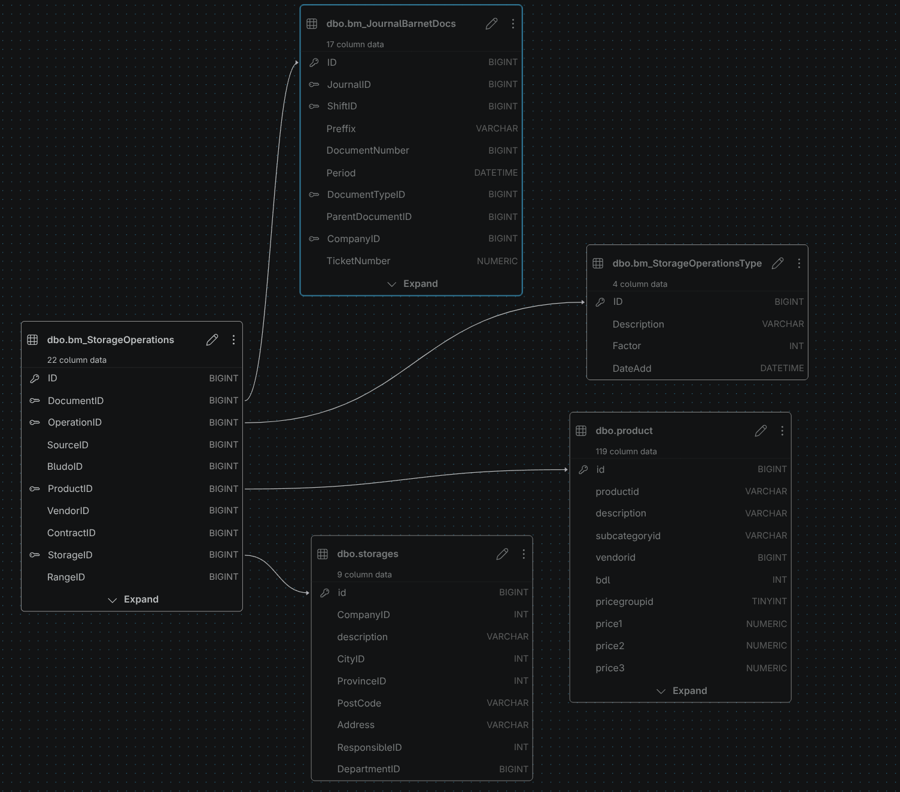
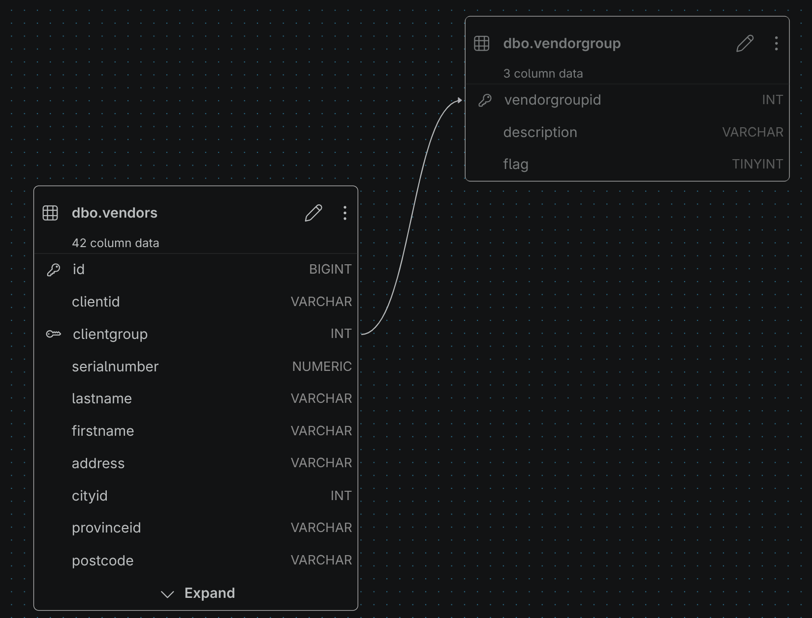
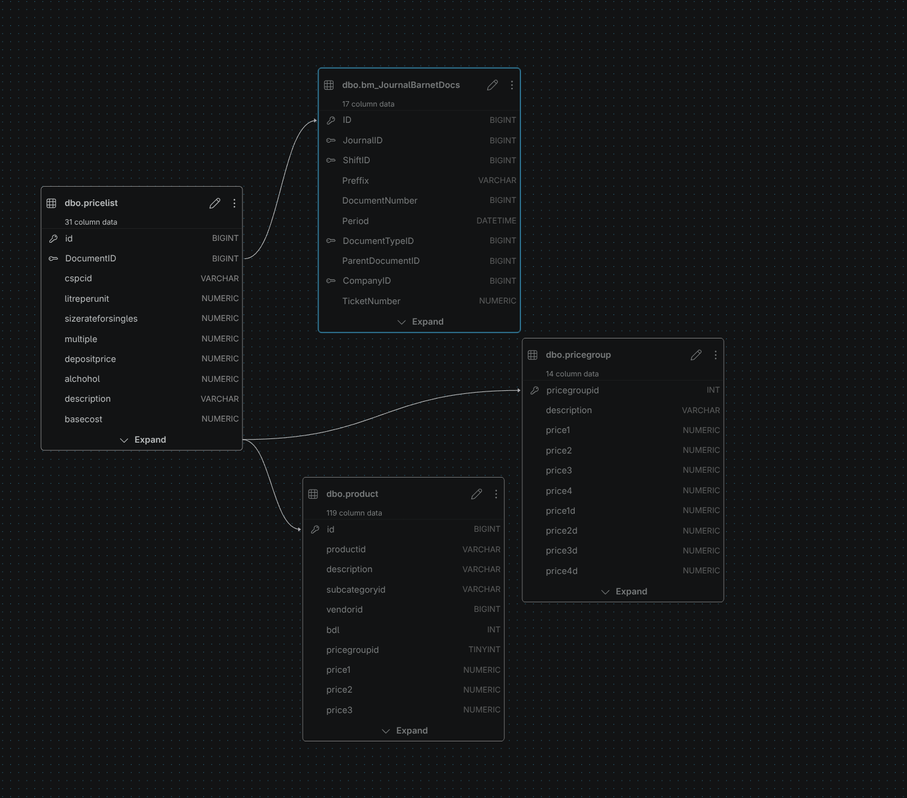
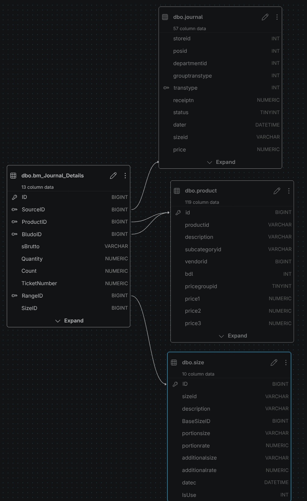
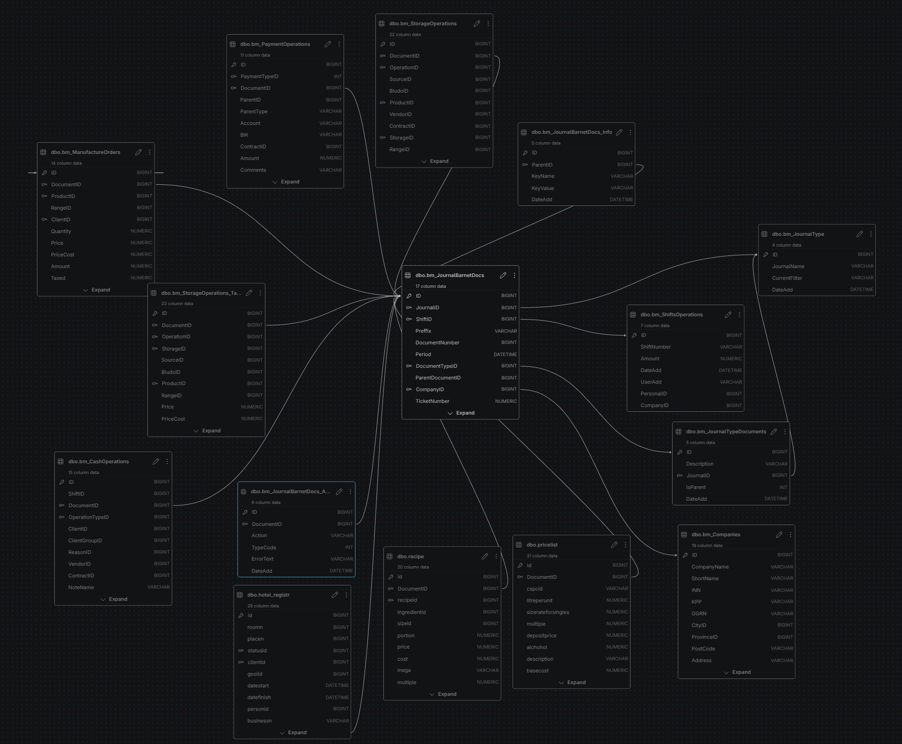
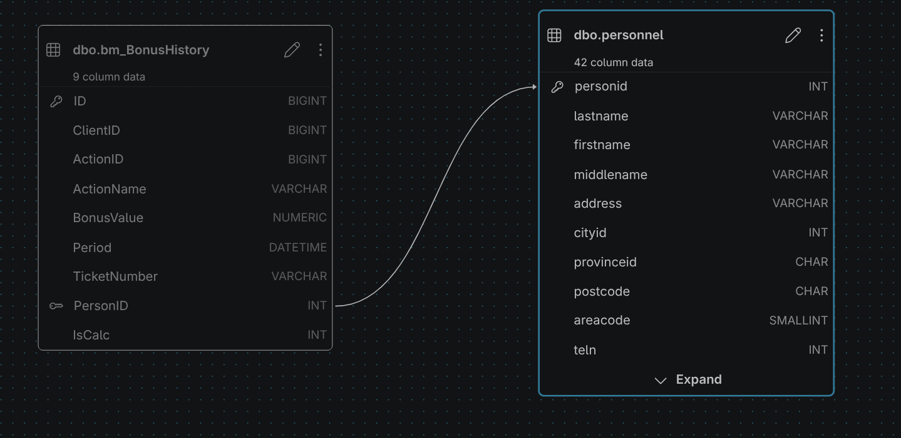

Запросы - в [`queries_analysis.sql`](queries_analysis.sql): проверка связей без FK через `LEFT JOIN` (`Всего` / `Нашлось`).

# 1 Закупки продукции

## 1.1 `bm_StorageOperations` - операции склада
Строк: **1031198**.

| Колонка | Назначение | Пример |
|---|---|---|
| `ID` | ID строки | `4780421` |
| `DocumentID` | документ | `388235` |
| `OperationID` | тип операции (`1` - поступление, `2` - списание) | `1` |
| `ProductID` | товар | `4368` |
| `BludoID` | блюдо | `0` |
| `VendorID` | поставщик | `200` |
| `StorageID` | склад | `41` |
| `RangeID` | единица измерения | `42` |
| `Price` | цена | `323.00` |
| `Count` | количество со знаком | `2.7640` |
| `Amount` | сумма со знаком | `892.77` |
| `ReasonID` | причина списания | `NULL` |
| `DateAdd` | дата и время | `2020-11-15 14:15:30` |

Связаны через внешний ключ: `bm_JournalBarnetDocs` - `DocumentID`, `bm_StorageOperationsType` - `OperationID`, `product` - `ProductID`, `storages` - `StorageID`.

Неявно связаны (без внешнего ключа): `vendors` - `VendorID`, `bm_ReasonDebit` - `ReasonID`, `product` - `BludoID`, `size`/`bm_classifierSizes` - `RangeID`.

## 1.2 `product` - товары и ингредиенты
Строк: **1545**.

| Колонка | Назначение | Пример |
|---|---|---|
| `id` | ID | `4337` |
| `productid` | внешний код | `1204073` |
| `description` | наименование | `Бананы` |
| `CategoryID` | категория | `200` |
| `SizeID` | единица измерения | `42` |
| `vendorid` | поставщик | `107` |
| `pricegroupid` | ценовая группа | `NULL` |
| `price1` | розничная цена | `NULL` |
| `cost` | себестоимость | `0.00` |
| `onhand` | остаток | `NULL` |
| `IsUse` | активность | `0` |

Связаны через внешний ключ: `category` - `CategoryID`, `recipe` - `recipeid`, `pricelist` - `productid`, `bm_Journal_Details` - `ProductID`/`BludoID`, `bm_StorageOperations` - `ProductID`.
Неявно связаны: `size` - `SizeID`, `vendors` - `vendorid`, `pricegroup` - `pricegroupid` (не заполнено), `journal` - `productid`.

## 1.3 `vendors` - поставщики
Строк: **63**.

| Колонка | Назначение | Пример |
|---|---|---|
| `id` | ID поставщика | `91` |
| `clientid` | краткое имя | `Габур` |
| `firstname` | наименование | `ИП Габур` |
| `clientgroup` | группа | `31` |
| `INN` | ИНН | `""` |
| `KPP` | КПП | `""` |
| `OGRN` | ОГРН | `""` |
| `IsUse` | активность | `1` |

Связаны через внешний ключ: `vendorgroup` - `clientgroup`.

Неявно связаны: `bm_StorageOperations` - `id`/`VendorID`, `product` - `vendorid`, `pricelist` - `vendorid`.

## 1.4 `pricelist` - цены
Строк: **24797**.

| Колонка | Назначение | Пример |
|---|---|---|
| `id` | ID строки | `234802` |
| `DocumentID` | документ | `465980` |
| `productid` | товар | `4377` |
| `groupid` | тип цены | `3` |
| `vendorid` | поставщик | `NULL` |
| `basecost` | базовая цена | `0.00` |
| `netcost` | себестоимость | `404.00` |

Связаны через внешний ключ: `bm_JournalBarnetDocs` - `DocumentID`, `product` - `productid`, `pricegroup` - `groupid`.

## 1.5 Справочники
| Таблица (строк) | Назначение | Пример |
|---|---|---|
| `bm_JournalTypeDocuments` (25) | виды документов | `Поступление продуктов` |
| `bm_JournalType` (6) | журналы | `Складской учет` |
| `category` (158) | категории товаров | `Пицца` |
| `size` (78) | единицы измерения | `100г` |
| `bm_classifierSizes` (402) | классификатор единиц | `Грамм` |
| `recipe` (11 812) | техкарты блюд | `4420` |
| `bm_AssortmentGroups` (1) | ассортиментные группы | `Без названия` |
| `pricegroup` (4) | типы цен | `Розничная` |
| `taxes` (1) | ставки НДС | `НДС 20` |
| `currency` (3) | валюты | `USD` |

---

# 2 Продажи товара

## 2.1 `journal` - продажи
Строк: **225681**.

| Колонка | Назначение | Пример |
|---|---|---|
| `transnumber` | ID строки | `1951181` |
| `receiptn` | номер чека | `50672281` |
| `dater` | дата и время | `2023-12-06 13:58:26` |
| `grouptranstype` | группа записи | `1` |
| `transtype` | вид записи (`101` - продажа, `211`/`216` - оплата, `501` - итог чека) | `101` |
| `id` | код товара | `7239833` |
| `description` | наименование | `Соус Барбекю` |
| `categoryid` | категория | `178` |
| `sizeid` | единица измерения | `1` |
| `quantity` | количество | `1.000` |
| `price` | цена | `50.00` |
| `amount` | сумма | `50.00` |
| `discountamount` | скидка | `0.00` |
| `loginid` | кассир | `906` |
| `customerid` | клиент | `""` |

Связаны через внешний ключ: `transtype` - `transtype`, `bm_Journal_Details` - `SourceID`.
Неявно связаны: `product` - `id`/`productid`, `personnel` - `loginid`, `clients` - `customerid`, `category` - `categoryid`, `size` - `sizeid`.

## 2.2 `bm_Journal_Details` - состав проданных блюд
Строк: **1089641**.

| Колонка | Назначение | Пример |
|---|---|---|
| `ID` | ID строки | `11530445` |
| `SourceID` | строка журнала | `1675591` |
| `ProductID` | ингредиент | `4407` |
| `BludoID` | блюдо | `4451` |
| `RangeID` | единица измерения | `42` |
| `Quantity` | количество порций | `1.0000` |
| `Count` | расход ингредиента | `0.4000` |
| `TicketNumber` | номер чека | `14740696` |
| `StorageID` | склад | `41` |
| `DateAdd` | дата и время | `2020-11-11 10:09:39` |

Связаны через внешний ключ: `journal` - `SourceID`, `product` - `ProductID`/`BludoID`, `size` - `RangeID`.
Неявно связаны: `storages` - `StorageID`, `journal` - `TicketNumber`.

## 2.3 `bm_BonusHistory` - история бонусов
Строк: **44866**.

| Колонка | Назначение | Пример |
|---|---|---|
| `ID` | ID записи | `1` |
| `ClientID` | клиент | `3352` |
| `BonusValue` | бонус | `0.00` |
| `Period` | дата | `2016-04-05 11:31:10` |
| `TicketNumber` | номер чека | `NULL` |
| `PersonID` | сотрудник | `897` |

Связаны через внешний ключ: `personnel` - `PersonID`.
Неявно связаны: `journal` - `TicketNumber`.

`BonusValue` - снимок баланса, не начисление.

## 2.4 Справочники
| Таблица (строк) | Назначение | Пример |
|---|---|---|
| `PreReceipt` (10 767) | предчеки и заказы | `ReceiptN=130200619` |
| `transtype` (81) | виды кассовых записей | `PLU Sales` |
| `paymenttype` (16) | виды оплаты | `Наличные` |
| `clients` (1 494) | клиенты | `clientid='1235'` |
| `clientgroup` (16) | дисконтные группы | `Дсконт карты` |
| `TimedDiscount` (89) | скидки по расписанию | `15.00%` |
| `reward` (8) | виды привилегий | `% Discount` |
| `bm_CashOperationsType` (7) | виды кассовых операций | `Выручка за смену` |

---

# 3 Взаимоотношения с поставщиками

## 3.1 `vendors` - поставщики

Уже описана в пункте 1.3. Строк: **63**.

## 3.2 `bm_JournalBarnetDocs` - документы
Строк: **55149**.

| Колонка | Назначение | Пример |
|---|---|---|
| `ID` | ID документа | `388235` |
| `JournalID` | журнал | `1` |
| `ShiftID` | смена | `65` |
| `DocumentTypeID` | тип документа (`4` - поступление, `6` - товарный чек) | `4` |
| `DocumentNumber` | номер | `1` |
| `Period` | дата | `2020-11-11 08:00:00` |
| `CompanyID` | организация | `6` |
| `TicketNumber` | номер чека | `NULL` |
| `Amount` | сумма | `892.77` |
| `PersonID` | сотрудник | `897` |

Связаны через внешний ключ: `bm_JournalTypeDocuments` - `DocumentTypeID`, `bm_JournalType` - `JournalID`, `bm_Companies` - `CompanyID`, `bm_ShiftsOperations` - `ShiftID`, `bm_StorageOperations` - `ID`/`DocumentID`, `pricelist` - `DocumentID`, `recipe` - `DocumentID`.
Неявно связаны: `journal` - `TicketNumber`, `personnel` - `PersonID`.

## 3.3 `vendorgroup` - группы поставщиков
Строк: **2**.

| Колонка | Назначение | Пример |
|---|---|---|
| `vendorgroupid` | ID группы | `31` |
| `description` | название | `Поставщики` |
| `flag` | признак | `0` |

Связаны через внешний ключ: `vendors` - `clientgroup`.

## 3.4 Справочники
| Таблица (строк) | Назначение | Пример |
|---|---|---|
| `bm_Companies` (1) | юрлица | `Пиzzбург` |
| `banks` (1) | банки | `АКБ "БРАТСКГЭССТРОЙ"` |
| `complaints` (3) | причины возвратов | `Отказ гостя` |

---

# 4 Работа персонала

## 4.1 `personnel` - сотрудники
Строк: **109**.

| Колонка | Назначение | Пример |
|---|---|---|
| `personid` | ID сотрудника | `898` |
| `lastname` | фамилия | `Безик` |
| `firstname` | имя | `Татьяна` |
| `securityaccess` | роль | `9` |
| `flagpos` | допуск к кассе | `0` |
| `deleteflag` | увольнение | `1` |
| `percent` | процент | `10.000` |
| `weight` | весовой коэффициент | `0.00` |

Связаны через внешний ключ: `bm_BonusHistory` - `PersonID`.
Неявно связаны: `securityaccess` - `securityaccess`, `journal` - `loginid`, `bm_JournalSessions` - `PersonID`, `bm_PersonnelSecurity` - `PersonID`, `bm_JournalBarnetDocs` - `PersonID`.

## 4.2 `bm_BonusHistory` - история бонусов
Уже описана в пункте 2.3. Строк: **44866**.

## 4.3 `journal` - продажи
Уже описана в пункте 2.1. Строк: **225681**.

## 4.4 `bm_JournalSessions` - журнал событий
Строк: **174072**.

| Колонка | Назначение | Пример |
|---|---|---|
| `ID` | ID записи | `1` |
| `Type` | источник | `Система` |
| `Message` | текст | `Произведена очистка журнала системных сообщений.` |
| `IsError` | ошибка | `0` |
| `DateAdd` | дата | `2019-10-10 10:09:48` |
| `PersonID` | сотрудник | `897` |

Неявно связаны: `personnel` - `PersonID`.

## 4.5 `bm_PersonnelSecurity` - права сотрудников
Строк: **1402**.

| Колонка | Назначение | Пример |
|---|---|---|
| `ID` | ID записи | `1397` |
| `PersonID` | сотрудник | `906` |
| `ObjectID` | объект доступа | `36` |
| `IsUse` | включено | `1` |

Связаны через внешний ключ: `bm_SecurityObjects` - `ObjectID`.
Неявно связаны: `personnel` - `PersonID`.

---

# 5 Остатки

## 5.1 `bm_StorageOperations` - движения склада
Уже описана в пункте 1.1. Строк: **1 031 198**.

## 5.2 `bm_StorageOperationsType` - виды операций
Строк: **5**.

| Колонка | Назначение | Пример |
|---|---|---|
| `ID` | ID типа | `1` |
| `Description` | название | `Поступление` |
| `Factor` | знак | `1` |

Связаны через внешний ключ: `bm_StorageOperations` - `OperationID`.

## 5.3 `bm_ReasonDebit` - причины списания
Строк: **47**.

| Колонка | Назначение | Пример |
|---|---|---|
| `ID` | ID причины | `1` |
| `ParentID` | родитель | `0` |
| `Description` | название | `Порча продукта` |

Неявно связаны: `bm_StorageOperations` - `ReasonID`.

## 5.4 `bm_Journal_Details` - списания
Уже описана в пункте 2.2. Строк: **1089641**.
